# Base de donnees : 

## definitions : 
- Ensemble d'informations modelisant les objets d'une partie du monde reel et servant de support a une application informatique 
- Collection organisee, interrogeable et persistante de donnees ou d'informations, concernant un theme donne pour l'entreprise 

- D'un point de vue plus informatique :
    - Ensemble de fichiers comprenant un certain nombre d'articles formes chacun d'un type de donnees, avec des liens entre ces articles 
    - ensemble d'operateurs permettant la recherche, le tri, la fusion ou toute autre oepration de meme type
    - ensemble de donnees ett de metadonnees(donnees qui decrivent les donnees) -> schema de la base 

## SGBD : Systeme de gestion des bases de donnees 
- Outil principal de gestion des bases de donnees 
- Ensemble de logiciels fournissant un environnement fournissant des applications pour : 
    - Decrire
    - memoriser 
    - manipuler 
    - traiter des ensemble de donnees 
    - en controler l'acces
    - partager ces donnees 
    - gerer des pannes 

### un peu de vocabulaire 
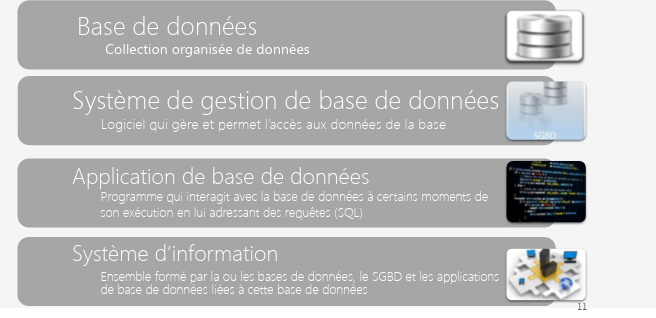

### differences entre base de donnees et feuille d'acceuil 

## Role dans les base de donnees 
differets types de personnes peuvent manipuler une base de donnees : 
- administrateurs 
- concepteurs 
- develeppeurs 
- utilisateurs 
### administrateurs : 
Administrateur de donnees ou DA 
- connaissance des donnees disponibles 
- acquisition et echange des donnees 
- animation du dispositif autour de la base de donnees 
 
Administrateur de bases de donnees ou DBA :

- integrite des donnees 
- securite et performance 
- aide au development et au test 
- recouvrement de donnees et gestion des pannes 
- validation et conseil 
- migration et mise a jour 

### Concepteurs : 
Concepteurs logiques : 
- s'interessent a l'ensemble de l'organisation a mettre en place,et en particulier a l'identification des donnees (entites,attributs,associations,contraintes) 
- travaillentt avec les utilisateurs futurs de la base de donnees 
 
concepteurs physiques 

- traitent le passage du modele logique de donnees vers un modele physique. Ils representent le schema logique en un ensemble de relations et de contraintes d'integrite, et s'interessent a la securite des donnees 
- travail qui depend fortement du SGBD choisi 

### developpeurs d'applications 
- realisent des applications de bases de donnees qui perment aux utlisateurs finaux d'utiliser/interagir avec la base de donnees 

### utilisateurs 
- clients de la base de donnees. Certains ne travaillent qu a traves le biais des applications de base de donnees et n'ont aucune connaissance dans le domaine de base de donnees 
- autres utilisateurs, plus experimentes peuvent ecrire leurs propres requetes SQL pour interroger la base de donnees 

## les etapes de conception d'une base de donnees : 
- analyse du systeme a modeliser 
- creation du modele de donnees 
- creation de la base de donnees dans un SGBD 

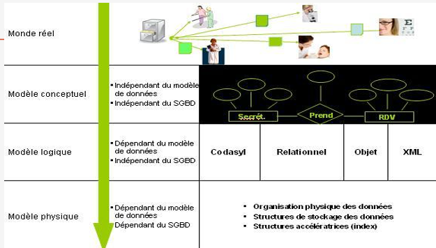

## Modelisation MCD 
### premiere etape : 
- recueillir les informations puis les transcrire sous une forme facilitant le passage a un modele de base de donnees (modele relationnel) 
- utilisation du modele entite-association (MERISE)
- autre possibilite : UML - diagramme de classes 

### premiere description du monde reel : 
- Comment apprehender ett simplifier le monde reel pour realiser une modelisation 
- Formulation des besoins sous forme de phrases simples : sujet - verbe . complement 
- Faire l'inventaire des objets du monde reel 
- decrire l'activite en termes simples 
- caracterises les liens entre les objets 

 
Description des donnees, des objets et des liens

### modele entite-association 
- representation graphique des informations recueillies dans un modele : MCD ou modele conceptuel des donnees 

### entite : 
une entite estt un objet specifique du monde reel 
- designe : une personne un , un objet, un concept abstrait , un evenement 
- caracterisee par son unicite 
- exemples d'entites : potion magique, tomate
### entites ou entites types : 
L'ensemble des entites qui ont la meme semantique et les memes proprietes forment un ensemble d'entites appele entite type 
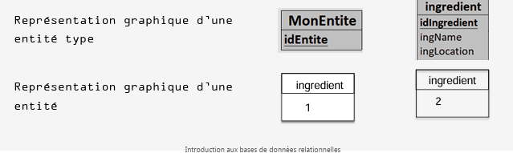

### Propriete ou attribut 
- toute entite-type possede des proprietes appelees attributs 
- exemple : nom de la personnem prenom , date de la naissance 

### identifiant : 
toute entite type a un identifiant : c'est un attribut ou ensemble d'attributs qui permet d'identifier chaque entite. 
- L'identifiant ne peut pas prendre la meme valeur pour deux entites distinctes 
- exemple : CIN , CNE ... 

### Representation graphique des entites : 
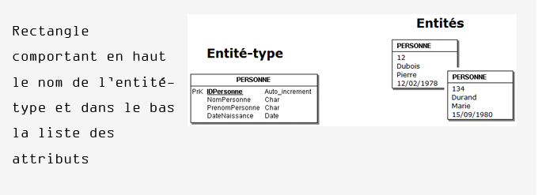
### Association : 
Une association represente un lien entre plusieurs entites. Elle peut contenir des attributs 
- exemple : Hamza possede le livre de code 1SBSN 
- une association type est un ensemble d'associations qui possedent les memes caracteristiques 
- une association-type represente un lien entre plusieurs entites-type 
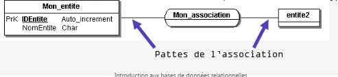

### cardinalite : 
- On definit une cardinalite sur chaque patte de l'association-type. Elle lie une entite-type est une association type et est composee de 2 nombres : 
 

 - la cardinalite est obligatoire pour chaque patte de l'association-type 
 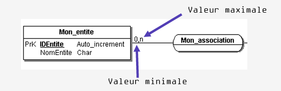
 
 ### cardinalite d'une association-type :
 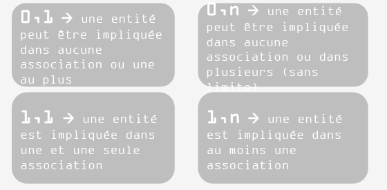
 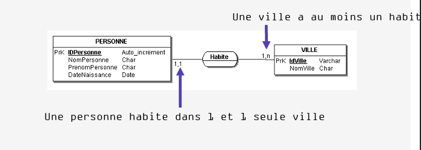
 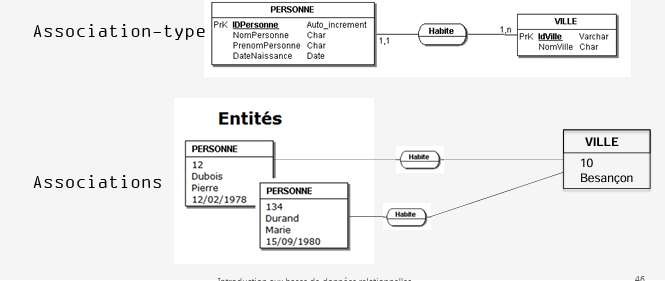
 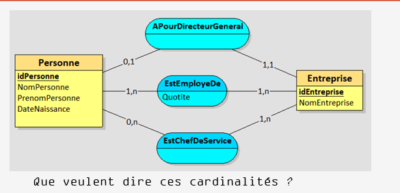

 ## construction d'un MCD _ les etapes : 
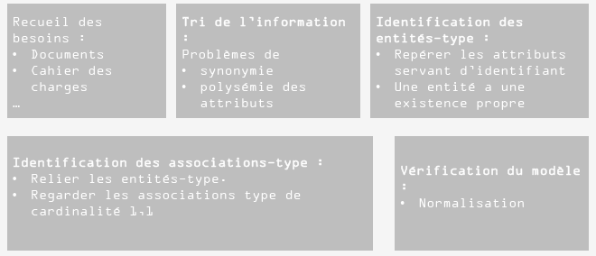
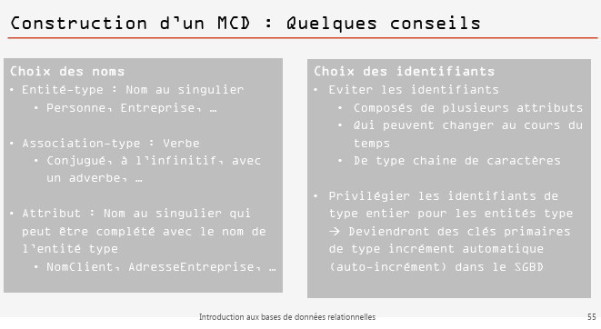
 
 ## Dictionnaire des donnees : 
 Document qui regroupe tous les attributs de la base de donnees 
 - pour chaque attribut on decrit : 
 - Nom : libelle decrivant l'attribut
 - descriptif : decrit a uoi sert l atrribut 
 - Taille : nombre de caracteres, entier long , court , reel , double .. 
 - information supplementaire : si neccessaire 

 # PARTIE 3 : Modele relationnel 
 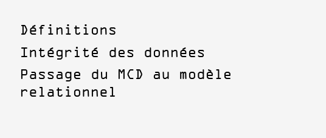
 ## definitions : 
 